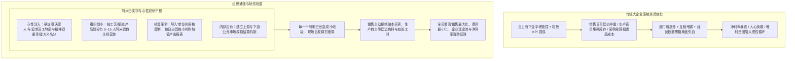

# 核心法典方法论技能：《活法》与阿米巴经营哲学

> **“所谓阿米巴经营，就是把组织划分成一个个小微自治团体，通过玻璃般透明的单位时间核算制，让每一个普通员工都变成具备经营者意识的主人。经营的真谛极其质朴：销售最大化、费用最小化，以至善的心灵成就长青基业。”**  
> —— 《活法》与阿米巴经营哲学

---

## 📚 1. 法典概览与核心立论 (Reading & Ingestion)

《活法》与阿米巴经营哲学（稻盛和夫 著）是世界企业史上关于**哲学与实学双轮驱动、大企业病根治与全员自主经营**的经典圣典。本法典熔铸了京瓷从 8 名员工的小作坊跃升为万亿跨国集团、日本航空在破产后短短一年实现世界第一盈利水平的深层方法论。

### 核心公理与底层立论
1. **哲学公理（心性原点）**：“作为人，何谓正确”。商业不仅是物质交换，更是心性投射。脱离了哲学灵魂的纯制度考核必然沦为钻空子与零和博弈；
2. **核算公理（单位时间附加值）**：企业唯一的生命力在于基层组织单位时间的真实产出能力。衡量阿米巴活力的终极标尺，是“每小时创造的新增附加价值（附加值/总工时）”，而非虚假膨胀的销售流水；
3. **组织细胞公理（自组织赋能）**：大企业的官僚化必然引发信息黑箱与责任蒸发。唯有将组织划小到“人人能够看清全貌、人人能够承担盈亏”的细胞阿米巴，方能彻底根除部门推诿。

---

## 🔬 2. 逻辑骨架与因果推演链 (Interpretation)

### 2.1 底层机制与因果系统模型

### 2.2 核心概念与算力骨架

#### 1. 单位时间核算方程式 (Hourly Value-Added Rate)
$$\text{总生产额} = \text{外部销售额} + \text{内部阿米巴结算出货额}$$
$$\text{毛净生产额 (附加价值)} = \text{总生产额} - \text{从外部采购额} - \text{从内部阿米巴采购额} - \text{其他各项直接费用}$$
$$\text{单位时间附加价值 (日元/小时 或 元/小时)} = \frac{\text{毛净生产额}}{\text{该阿米巴全员投入总工时 (正常工时 + 加班工时)}}$$

- **指标灵魂**：
  - 分母不仅包含正常上班时间，更严厉包含**加班时间**。阿米巴长为了提高“单位时间产出”，会主动消除无效磨洋工与无谓加班；
  - 分子扣除了所有内部与外部成本，倒逼阿米巴长自主节约原材料、电费、刀具磨损与运费。

#### 2. 阿米巴划分三原则
1. **能够独立核算收支**（必须有清晰的投入与产出边界）；
2. **能够独立完成业务闭环**（作为最小工作单元具有完整功能）；
3. **符合公司最高战略与组织和谐**（绝不可因划分而损害整体利益）。

---

## 🎯 3. 实战应用映射与决策树 (Appropriation)

### 3.1 业务场景适配矩阵

| 业务场景 | 典型痛点症状 | 阿米巴法典处方 | 预期收效 |
| :--- | :--- | :--- | :--- |
| **陷入恶性低价内卷** | 销售为了冲业绩随意打折，生产部背负亏损订单，公司增收不增利 | 实施“定价即经营”铁律，将订单毛利与销售阿米巴单位时间直接挂钩，低于基准线订单销售端自担亏损 | 斩断亏损订单，毛利率 30 天内企稳反弹 |
| **生产库存严重积压** | 生产车间只顾开足马力刷产值，导致半成品与成品仓库爆满，现金沉淀成死货 | 实施“现款现货与即时交付”核算。未被客户或下游阿米巴签收的半成品，不得计入生产额，反计库存保管费 | 车间主动按需定产，在制品库存降低 40% 以上 |
| **采购端暗箱与推诿** | 采购部门以供应商断货为由采购高价或劣质物料，私拿返点回扣 | 推行“玻璃般透明采购”。所有采购物料价格、供应商比价表张贴公布，生产阿米巴有权对不合格物料发起索赔 | 消除灰色空间，采购成本直降 8%~15% |
| **骨干缺乏主人翁意识** | 核心人员打卡摸鱼，遇到问题归咎于制度和老板 | 选拔年轻骨干担任阿米巴长，每日盘点单位时间核算，召开“阿米巴空巴（思想交流会）”共研经营 | 唤醒自燃性，基层员工由被动听令变为主动精进 |

### 3.2 绝对禁忌场景 (Negative Constraints)
- **绝对禁忌 1：仅学阿米巴算账，不学经营哲学**。如果只导入阿米巴核算表格，却缺乏“利他”、“敬天爱人”的哲学熏陶，阿米巴之间会演变为极端利己的自私争吵与恶性截流；
- **绝对禁忌 2：将单位时间核算直接等同于员工当月绩效奖金**。阿米巴核算重在唤醒荣誉感与经营意识，若直接简单按阿米巴盈利发放提成，会导致阿米巴之间拒绝协作，最终撕裂组织。

---

## 🔍 4. TV 三重严格验证 (Triple Verification)

1. **跨领域佐证度**：
   - 对应复杂科学中的“细胞自动机 (Cellular Automata)”与去中心化自组织理论；对应现代精益制造（丰田 TPS）的单件流与消除浪费（Muda）。
2. **推演预测力**：
   - 京瓷 60 年从未亏损；日本航空在申请破产后，通过推行阿米巴与经营哲学，仅用 14 个月从亏损千亿转为利润世界第一，成功在东京证交所重新上市。
3. **反常识与非显而易见性**：
   - 常识认为“降低成本靠集中采购与规模效应”；阿米巴揭示“真正的低成本来自于一线每一个细胞对每一个工时、每一克物料的极致抠唆与现场精进”。

---

## ⚙️ 5. ++ Agent 可执行层封装 (Agent Execution Layer)

### 5.1 触发器与路由条件 (Triggers)
- 当企业面临：毛利率恶化、各部门互相指责甩锅、库存异常升高、员工缺乏积极性、创始人深感孤独力竭时，必须激活本法典。

### 5.2 前置输入检查清单 (Pre-condition Input Checklist)
- [ ] 企业近 6 个月各事业部独立损益表（P&L）与资产负债表；
- [ ] 现行组织架构图与全员岗位编制清单；
- [ ] 各工序平均制造周期、在制品存量与呆滞库存清单；
- [ ] 外部销售渠道的实际成交折让与账期结构。

### 5.3 落地检查清单 (Checklists)
- 见配套参考文档：[`references/checklists.md`](references/checklists.md)。
