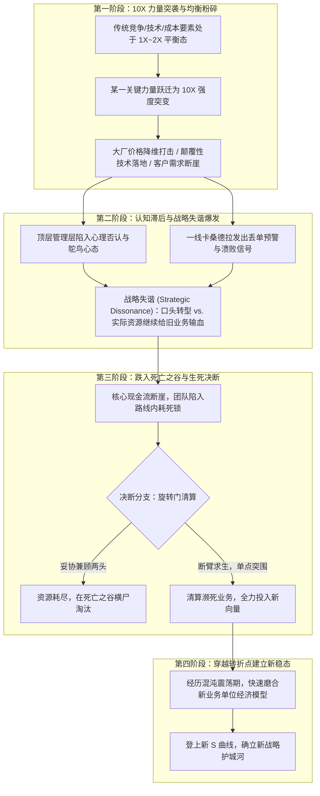

# 核心法典方法论技能：《只有偏执狂才能生存》 (Only the Paranoid Survive)

> **“战略转折点是每个企业生命周期中不可避免的死亡考验。在转折点面前，原本有效的规则会全部失效，唯一能拯救你的，是对环境保持极度偏执的清醒与绝不妥协的决断。”**  
> —— 《只有偏执狂才能生存》

---

## 📚 1. 法典概览与核心立论

《只有偏执狂才能生存》（安迪·格鲁夫 著）是现代商业史上关于**非连续性危机、技术突变与企业极限自救**的经典法典。本书解构了英特尔在 20 世纪 80 年代遭遇日本厂商低价存储器降维打击时，如何通过放弃起家基石 DRAM、全面转向微处理器实现浴火重生的残酷历程。

### 核心公理与底层立论
1. **外部动力学公理**：在任何行业中，推动商业格局变迁的力量必然会发生从 1X 到 **10X 级别**的剧烈跃迁。当某项关键竞争要素发生数量级突变时，旧有的商业均衡被彻底粉碎，原有的成功法则瞬间变为负资产。
2. **战略转折点不可逆公理**：战略转折点（Strategic Inflection Point, SIP）不是暂时的逆境，而是产业地貌的结构性相变。任何试图“熬过寒冬等待行业复苏”的组织必遭毁灭。
3. **死亡之谷零对冲公理**：在旧曲线衰亡与新曲线建立之间，存在充满混沌与资源枯竭的“死亡之谷”。试图在死亡之谷中向新旧两端同时下注以图对冲风险，必然导致有限资源被稀释殆尽，从而在谷底活活耗死。唯有在旧业务尚有余温时主动扣动扳机，集中全部筹码单一突围，方能生存。

---

## 🔬 2. 逻辑骨架与因果推演链 (Interpretation)

### 2.1 底层机制与因果系统模型



### 2.2 核心概念拓扑图
- **波特六力扩展模型**：在现有竞争者、供应商、客户、替代品、潜在进入者之外，引入**关键互补品 (Complementors)** 的作用力。任何一力的量级放大至 10X，都会引发连锁相变。
- **战略转折点双 S 曲线**：
  - 曲线 A（旧业务）：经历诞生、繁荣、饱和，在 10X 力量打击下步入不可逆的衰退悬崖；
  - 曲线 B（新突围向量）：具备未来空间，但早期不确定性极高、毛利模型未收敛；
  - 奇点（转折点）：两条曲线交织的迷雾区域。
- **战略失谐测量仪**：
  $$\text{失谐系数} = \frac{\text{投向旧业务的实际资源（现金、顶级工时、激励})}{\text{管理层口头宣称的战略新重点权重}}$$
  当失谐系数 $> 1.5$ 且现金储备 $< 6$ 个月时，企业处于极度濒危状态。

---

## 🎯 3. 实战应用映射与决策树 (Appropriation)

### 3.1 业务场景适配矩阵

| 场景类型 | 典型症状 | 法典处方 | 预期收效 |
| :--- | :--- | :--- | :--- |
| **大厂低价降维打击** | 巨头以 1/5 甚至免费策略打包相同功能，中小团队大客户流失率突破 20% | 立即停止同质化功能消耗战，启动旋转门清算，切向巨头不愿做或做不深的垂直深水区 | 止住无意义价格失血，保住核心毛利 |
| **现金枯竭下的内耗死锁** | 现金仅剩 3~6 个月，CTO 狂热押注新技术，销售 VP 执念定制接单苟延残喘 | 召开战时建设性冲突会议，戳穿伪工作，以 100% 现金归流为硬指标强行定盘 | 24 小时内解除内耗死锁，锁定战时指挥权 |
| **伪转型与战略失谐** | 宣称全员拥抱 AI/出海，但 80% 研发工时仍在给濒死的大客户做非标定制 | 用“看硅片分配”律实施资源强行再分配，设立财务出纳与研发排期双重防火墙 | 终结两头不讨好的资源撕裂，集中兵力冲出死亡之谷 |

### 3.2 绝对禁忌场景 (Negative Constraints)
- **绝对禁忌 1：稳态增长期企业进行破坏性休克疗法**。在业务处于确定性红利、外部无 10X 威胁时，滥用战时断臂会导致自我肢解。
- **绝对禁忌 2：为了转型而发明伪需求**。格鲁夫的突围向量必须建立在真实客户的付款意愿与未被满足的痛点上，绝非 CTO 个人对前沿技术的技术自嗨。

### 3.3 战时重组决策树 (Wartime Reorganization Decision Tree)

```text
[当前企业遭遇危机]
  │
  ├─ 是否存在 10X 外部力量正在永久性摧毁旧有毛利基础？
  │    ├─ 否 ──> 判定为常规运营震荡，执行精细化降本增效，无需休克重组。
  │    └─ 是 ──> 进入【战略转折点应急状态】
  │
  ├─ 现金储备是否低于 6 个月？
  │    ├─ 否 ──> 设立内部创新特区，进行双轨灰度迁移。
  │    └─ 是 ──> 判定为【死亡之谷极限生存态】，禁止任何灰度对冲！
  │
  ├─ 执行【旋转门思想实验】：新来的清算型 CEO 会怎么做？
  │    ├─ 立即裁撤：持续失血、无复购、毛利为负的定制业务与研发虚荣项目；
  │    └─ 立即集结：所有可用资金与核心技术骨干，压向唯一生存向量。
  │
  └─ 启动战时指挥部：推行“建设性对抗 -> 反对但全力服从”闭环。
```

---

## 🧪 4. 三重验证审计报告 (Triple Verification)

1. **跨学科/跨领域佐证度 (Cross-Domain Evidence)**：
   - *热力学与耗散结构理论*：开放系统远离平衡态时，必须通过大量吐故纳新（消除高熵旧业务，引入低熵新动能）才能维持有序组织，否则系统必然由于内耗而熵增解体；
   - *演化生物学间断平衡论 (Punctuated Equilibrium)*：生物演化不是匀速平滑的，而是在长期的停滞期中突然遭遇极端气候冲击，绝大部分旧物种迅速灭绝，唯有高度特化适应新环境的突变体得以幸存。
2. **推演预测力 (Predictive Power)**：
   - *成功验证 1 (英特尔 1985)*：果断放弃占据营收 80% 的 DRAM，裁减 8000 名员工，集中力量压注微处理器，成就其后 PC 时代的芯片霸王；
   - *成功验证 2 (微软 1995)*：比尔·盖茨发布著名的《互联网海啸》备忘录，将全部 Windows 和 Office 核心资产转向支持浏览器与网络协议；
   - *失败反例 1 (柯达 2000s)*：虽然最早发明数码相机，但因过于留恋胶卷的高额垄断毛利，在死亡之谷试图两手对冲，最终于 2012 年申请破产保护；
   - *失败反例 2 (诺基亚 2007–2011)*：面对 iPhone 的 10X 冲击，高管层长期漠视一线卡桑德拉的警告，战略失谐长达数年，最终智能手机业务惨遭贱卖。
3. **反常识与非显而易见性 (Non-Obviousness)**：
   - *常识误区*：“船大掉头难，应该小步慢跑，用老业务赚的钱慢慢孵化新业务”；
   - *格鲁夫非共识洞见*：**老业务在面临 10X 冲击时根本赚不到钱，只会加速亏损并把新业务拖下水！** 当你还在小步慢跑时，你的现金储备已经归零。真正的活路是在老业务彻底死透之前，主动将其剥离或关停，将残存的所有氧气输送给新物种。

---

## ⚙️ 5. Agent 可执行工具箱 (Agent Execution Layer ++)

### 5.1 触发条件 (Triggers)
当用户或业务环境出现以下任一信号时，自动调动本法典：
- 核心指标出现“断崖式滑坡”（客户流失率 $> 20\%$，竞品价格降至原本的 $1/3$ 以下）；
- 账面可用现金储备低于 6 个月安全生命线；
- 管理层出现分裂性战略内耗（技术主管主张颠覆性下注，业务主管主张低价接单苟延残喘）；
- 用户提出“如何带领团队断臂求生”、“如何应对大厂降维打击”。

### 5.2 前置输入清单 (Prerequisites)
在起草战时重组总案前，必须采集以下 4 组刚性客观数据：
- [ ] **现金流体检表**：未经粉饰的净现金储备、月度净流出金额（Burn Rate）、纯自然生存月数；
- [ ] **客户损益解剖图**：现有客户的真实毛利率、定制化研发与售后支持工时占比、过去 90 天主动解约客户的真实访谈口述；
- [ ] **研发资源分配台账**：全员过去两个月的真实工时去向（维护旧代码 vs. 新业务攻坚）；
- [ ] **大厂竞品杀伤力报告**：大厂产品的真实价格区间、免费策略覆盖范围、技术代差与客户核心转移门槛。

### 5.3 战时重组五步标准执行规程 (Wartime 5-Step SOP)

1. **第 1 步：旋转门清算诊断 (The Revolving Door Audit)**
   - 假定现有创始团队全部被解职，由清算人独立接管；
   - 列出“死穴清单”：无情找出哪项业务每运营一天就在净亏损一天；
   - 判定旧业务的真实剩余价值，制定 48 小时极速止血方案。
2. **第 2 步：战略失谐暴力矫正 (Dissonance Realignment)**
   - 宣布企业进入“战时状态”，冻结非核心产品线的研发代码提交权限与采购预算；
   - 取消与未来战略相抵触的考核与提成机制，将激励与“现金回款”和“标准化突围指标”挂钩。
3. **第 3 步：选定单点突围向量 (Vector Selection)**
   - 根据大厂巨头的软肋与自身不可替代的深水区壁垒，选定唯一的生存向量；
   - 拒绝“兼顾两头”，将全部剩余工程与市场兵力向突围向量进行饱和配置。
4. **第 4 步：设立卡桑德拉直通雷达 (Cassandra Direct Link)**
   - 建立周度一线穿透机制：CEO/总指挥每周直接审查丢失订单复盘报告，与 3 位一线技术/销售深谈；
   - 严厉惩处隐瞒丢单、粉饰太平的中层官僚行为。
5. **第 5 步：建设性冲突与决断签署 (Constructive Confrontation & Sign-off)**
   - 召开闭门战时重组大会，撕毁体面假象，直面最坏破产可能；
   - 签署全员连带军令状（Disagree and Commit），形成不可逆的《谢幕破局档案》。

### 5.4 验收与质检清单 (Checklists)
- [ ] **C1（止血彻底性）**：方案是否在 30 天内将每月净现金流出削减 50% 以上？（Yes/No）
- [ ] **C2（战略聚焦度）**：方案是否彻底排除了“两头对冲”的幻想，将至少 80% 的工程兵力集中于单一新向量？（Yes/No）
- [ ] **C3（激励一致性）**：方案是否重新设计了薪酬与考核机制，确保员工不再因维护濒死旧业务而获益？（Yes/No）
- [ ] **C4（现金生命线）**：重组后企业的生存周期是否被强行拉长至至少 9 个月以上？（Yes/No）

### 5.5 反模式与陷阱警示 (Anti-Patterns)
- **陷阱 1：用热词包装掩盖商业无能（The Buzzword Mask）**  
  - *症状*：技术负责人高喊 AI Agent、大模型革命，但说不清第一个付费客户是谁、如何收回成本。  
  - *纠偏*：技术只是杠杆，商业才是支点。任何不产生真实毛利与续费承诺的技术攻坚，在战时一律视为自杀性伪工作。
- **陷阱 2：饮鸩止渴的亏损定制（The Customization Quicksand）**  
  - *症状*：销售负责人为了保住表面业绩，不断接取高定制化、非标私有化大单，占用 80% 研发资源。  
  - *纠偏*：非标定制本质上是软件公司的鸦片。它看似带来了现金流，实则把研发团队降级为外包工，让产品失去规模化可能，并在交付延期与尾款拖欠中耗尽企业最后的生命力。
