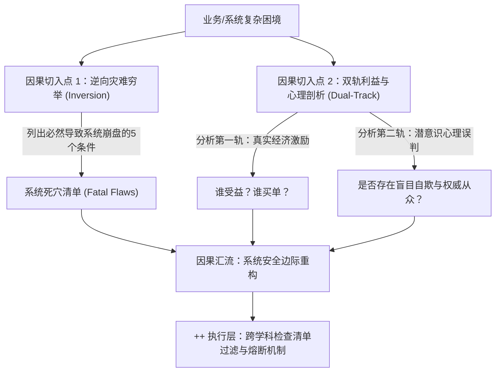

# 核心法典方法论技能：《穷查理宝典》 (Poor Charlie's Almanack)

> **原著整理**：彼得·考夫曼 (Peter D. Kaufman) 编纂 / 查理·芒格 著  
> **仓颉蒸馏流派**：认知反脆弱与理性决策法典  
> **在歌剧院中的职责**：为第三幕实战履职提供严密的逆向风险审计、双轨利益剖析与可落地的检查清单操作规程。

---

## 🏛️ 一、法典概览与核心公理 (Reading & Ingestion)

《穷查理宝典》汇集了查理·芒格数十年关于商业、投资与处世哲学的精髓，其核心论点由以下三条底层公理支撑：
1. **真实世界是高度非线性和跨学科交织的**：任何试图用单一学科（如单纯财务、单纯技术或单纯营销）解决复杂现实问题的企图，都是“拿着锤子找钉子”的自欺欺人；
2. **消灭愚蠢比追求伟大更具有确定性**：成功往往不是因为我们做对了多么复杂的天才举动，而是因为我们数十年如一日地避开了那些常人必然踩中的愚蠢陷阱；
3. **人类心理机制具有系统的可预测偏误**：当激励机制扭曲且伴随心理倾向共振时，整个系统必然滑向灾难。

---

## ⚙️ 二、逻辑骨架与因果推演链 (Interpretation)



- **系统崩塌的因果机制**：
  单向乐观假设 -> 忽视利益激励中的败德诱惑 -> 触发社会认同与从众心理共振（鲁拉帕鲁萨） -> 击穿安全冗余 -> 系统性暴雷；
- **系统救赎的因果机制**：
  主动逆向思考 -> 先行切断有毒激励 -> 强制引入跨学科清单审查 -> 设定极度保守的安全边际 -> 构筑反脆弱护城河。

---

## 🎯 三、实战应用场景映射 (Appropriation)

### 1. 黄金适配业务场景
- **企业遭遇增长失速与战略迷茫**：需要剥离虚荣业务，重回核心能力圈；
- **重大投资、并购或技术选型决策**：需要严苛排查隐蔽的尾部风险与虚假财务包装；
- **组织内耗与败德行为泛滥**：需要重新审计考核激励机制与权责边界；
- **高风险危机公关与止血救亡**：需要在信息混乱中快速做出断臂求生决断。

### 2. 绝对禁忌场景 (反向边界)
- **纯粹的短期高频套利或投机交易**：宝典拒绝一切依赖运气和微小随机波动的博弈；
- **需要盲目豪赌的狂热风口试错**：缺乏安全边际与基本商业常识的项目会被宝典彻底一票否决。

---

## 🔍 四、三重验证审计报告 (Triple Verification)

1. **跨学科佐证度 (Cross-Domain Evidence)**：
   - 物理学：热力学第二定律（孤立系统必然熵增，必须持续注入外部做功）；
   - 工程学：大型桥梁与航天器的“后备安全系数（冗余度）”原则；
   - 生物学：演化生物学中的“红皇后假说”与特化生态位竞争。
2. **推演预测力 (Predictive Power)**：
   - 成功预测 2000 年互联网科技泡沫破灭；
   - 提前数年精准预警华尔街复杂金融衍生品（CDO/CDS）将引发系统性金融海啸（2008 次贷危机）。
3. **非显而易见性 (Non-Obviousness)**：
   - 颠覆“只要项目估值足够便宜就可以买”的平庸常识，确立“宁可用合理价格买卓越企业，也不以便宜价格买平庸企业”；
   - 颠覆“如何才能成功”的常规提问，建立“只要列出怎么会死并坚决躲开”的逆向决策范式。

---

## 🛠️ 五、Agent 可执行工具箱 (Agent Execution Layer ++)

### 5.1 触发条件 (Triggers)
- 当推演任务涉及：**重大资产重组、新业务立项、危机止血、管理制度重构、高风险决策**时，自动激活本法典。

### 5.2 前置输入检查清单 (Prerequisites)
- [ ] **真实的财务与现金流底账**：剥离一切公关粉饰与口头承诺；
- [ ] **完整的激励与考核规则细则**：明确利益分配与损失承担方；
- [ ] **核心决策者的过往履约信誉记录**。

### 5.3 标准操作规程 (Execution SOP)

```text
步骤 1：执行【逆向死穴清算】
       -> 强行穷举当前项目走向惨败的 5 个最直接死因；
       -> 建立绝对不可触碰的物理防线。

步骤 2：执行【双轨利益与心理剖析】
       -> 追踪资金流向与权责分布；
       -> 审计是否存在群体性自欺或管理层权威迷信。

步骤 3：执行【能力圈划定与剪枝】
       -> 区分“核心能力圈资产”与“太难/不可控资产”；
       -> 制定止血与业务剥离时间表。

步骤 4：执行【安全边际与鲁棒性加固】
       -> 按最坏情景增加 30%~50% 的现金与资源冗余；
       -> 建立实时熔断开关。

步骤 5：过筛【法典质检清单】并签署交付物。
```

### 5.4 验收质检清单 (Checklists)
- [ ] **清单项 1**：方案中是否包含至少 3 条明确的“一票否决红线禁令”？
- [ ] **清单项 2**：方案是否指出了至少 1 项因激励机制扭曲导致的系统性漏洞？
- [ ] **清单项 3**：方案是否基于“最恶劣环境假设”提供了充足的安全边际？
- [ ] **清单项 4**：方案是否彻底排除了“因为别人都在做所以我们也做”的盲目羊群逻辑？

### 5.5 反模式警示 (Anti-Patterns)
- **假逆向陷阱**：表面上做了逆向思考，但最后依然得出“万无一失”的乐观结论 -> **纠偏**：强制设立魔鬼辩护人角色，不击穿方案誓不罢休；
- **清单形式主义**：把检查清单当成行政打勾表格，而非具有一票否决权的熔断器 -> **纠偏**：任何一项不通过，全盘方案自动驳回。
