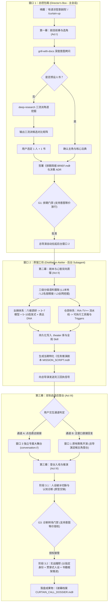

# 🎭 凉笙歌剧院 (Liangsheng Opera House)

[](https://opensource.org/licenses/MIT)
[](https://github.com/liangshengsheng12333/liangsheng-theater)
[](https://github.com/liangshengsheng12333/liangsheng-theater/releases)
[](https://github.com/liangshengsheng12333/liangsheng-theater)

> **沉浸式认知蒸馏与实战大师咨询剧场 · 工业级 Agent Skill 架构**  
> *"台上皆为古今哲匠，案头尽是万卷经纶；幕起之时解构盲区，曲终之刻定策乾坤。"*

---

## 🎭 一、系统概览与设计哲学

“凉笙歌剧院”旨在彻底消除传统大模型角色扮演中“浮于表面、口吻坍塌、泛泛而谈、缺乏硬核方法论”的顽疾。通过**物理三窗口隔离调度协议**与**严密的三幕式全生命周期流水线**，歌剧院将：
1. **女娲范式 ([alchaincyf/nuwa-skill](https://github.com/alchaincyf/nuwa-skill))**：人类历史智囊的心智操作系统（3~7核心思维模型、5~10决策启发式、原生表达DNA、三层保真度）；
2. **仓颉范式 ([kangarooking/cangjie-skill](https://github.com/kangarooking/cangjie-skill))**：经典法典的 RIA-TV++ 可执行方法论（因果推演链、业务场景映射、执行清单 Checklists 与 Triggers）；

深度熔炼为当期专属实战智囊，在第三幕以**原型心智破冰诊断**，经**转场门禁**后以**任务职责（Stage Duty）**接管战场，贯穿第一人称与章节箴言防线，交付工业级实战方案。

---

## 🏛️ 二、三幕式全生命周期与窗口架构



---

## 📂 三、项目资产与目录架构

```text
d:\项目\歌剧院\
├── SKILL.md                           # 歌剧院核心技能定义 (符合 Agent Skills 规范)
├── README.md                          # 本使用指南与全局部署文档
├── THEATER_BLUEPRINT.md               # 歌剧院系统架构蓝图
├── GLOSSARY.md                        # 剧院领域模型词汇表
├── docs/adr/                          # 历次架构与选角决策记录 (ADR 0001 ~ 0005)
├── templates/                         # 上游蒸馏标准与交付模板
│   ├── nuwa_distill.md                # 女娲 6D 调研与心智操作系统萃取模板
│   ├── cangjie_distill.md             # 仓颉 RIA-TV++ 技能化蒸馏模板
│   ├── mission_script.md              # 当期任务特化推演剧本模板
│   └── curtain_call_dossier.md        # 终局谢幕成果档案模板
├── scripts/
│   └── sync-to-global.ps1             # 一键同步至全局技能库 PowerShell 脚本
└── .theater/                          # 核心资产持久化空间 (跨项目复用)
    ├── library/                       # 仓颉法典技能库
    │   ├── poor-charlies-almanack/    # [官方预置法典 1] 《穷查理宝典》 (逆向思维/双轨分析/跨学科清单)
    │   ├── only-the-paranoid-survive/ # [官方预置法典 2] 《只有偏执狂才能生存》 (10X力/战略转折点/战时重组)
    │   └── a-compass-to-fulfillment/  # [官方预置法典 3] 《活法》与阿米巴哲学 (敬天爱人/单位时间核算/经营原点)
    ├── actors/                        # 女娲智囊心智库
    │   ├── charlie-munger/            # [官方预置智囊 1] 查理·芒格 (多元心智/格栅哲学/25种心理误判)
    │   ├── andy-grove/                # [官方预置智囊 2] 安迪·格鲁夫 (硬汉战时CEO/旋转门清算/卡桑德拉预警)
    │   └── kazuo-inamori/             # [官方预置智囊 3] 稻盛和夫 (敬天爱人/人生方程式/阿米巴自组织)
    └── sessions/                      # 历次推演工程档案
        ├── demo-session-munger-enterprise-crisis/   # [预置演练 1] 企业出海关税危机与重组
        ├── test-session-grove-saas-crisis/          # [预置演练 2] 20人 B2B SaaS 战略转折点死锁突围
        └── session-test-inamori-amoeba-crisis/      # [预置演练 3] 1.5亿制造与跨境电商阿米巴重组
```

---

## 🏛️ 四、官方即开即用智囊与法典库 (Official Out-of-the-Box Roster)

歌剧院自带以下经过女娲与仓颉工业级三层验证的黄金搭档，用户可直接点名秒开戏，无需等待第二幕蒸馏：

| 流派定位 | 智囊主角 (Protagonist) | 核心法典 (Canon) | 擅长领域与破局视角 | 预置资产路径 |
| :--- | :--- | :--- | :--- | :--- |
| **认知对抗派** | **查理·芒格**<br>*(Charlie Munger)* | **《穷查理宝典》**<br>*(Poor Charlie's Almanack)* | 多元思维模型格栅、逆向灾难推演、双轨利益审查、消灭系统性愚蠢 | `.theater/actors/charlie-munger/`<br>`.theater/library/poor-charlies-almanack/` |
| **激进破局派** | **安迪·格鲁夫**<br>*(Andy Grove)* | **《只有偏执狂才能生存》**<br>*(Only the Paranoid Survive)* | 10X 外部突变力量、跨越死亡之谷、旋转门战时清算、战略失谐暴力矫正、卡桑德拉丢单雷达 | `.theater/actors/andy-grove/`<br>`.theater/library/only-the-paranoid-survive/` |
| **系统治理派** | **稻盛和夫**<br>*(Kazuo Inamori)* | **《活法》与阿米巴哲学**<br>*(A Compass to Fulfillment)* | 人生方程式（思维方式×热情×能力）、动机至善私心了无、阿米巴划小单元核算、透明经营与人心重聚 | `.theater/actors/kazuo-inamori/`<br>`.theater/library/a-compass-to-fulfillment/` |

---

## 🚀 五、在当前工作区直接调用

### 1. 唤醒剧院总导演
在当前会话直接输入：
- 自然语言口令：“**有请凉笙歌剧院**” 或 “**歌剧院开戏**”
- 快捷暗号指令：“**/curtain-up**” 或 “**/opera**”

总导演将三声清钟入场，拉开第一幕。

### 2. 第一幕交互（质询与角逐）
- 向总导演陈述您的现实困境；
- 若您已有心仪角色与书籍，可直接告知（例如：“我想点安迪·格鲁夫带《只有偏执狂才能生存》” 或 “我想让芒格先生来”）；
- 若未指定，总导演将调用搜索给出**激进破局派**、**稳健系统派**、**认知对抗派** 3 组候选矩阵供您一键裁决；
- 审阅生成的《排期简报》，回复“**简报确认，开工蒸馏**”（或回复“可以/开始吧/同意”等肯定意图）即可放行第二幕。

### 3. 第二幕后台高效蒸馏 (L1~L3 分级)
- **L1 级（本地秒开）**：若点选上述官方预置库（芒格、格鲁夫），系统直接装载，跳过重复提取；
- **L2 级（公版名宿精准萃取）**：针对公众熟知人物（如马斯克、稻盛和夫、王阳明），调用内建高保真知识库 + 靶向精准验证，30~60 秒极速落盘；
- **L3 级（全网深度挖掘）**：针对冷门人物或用户私有企业资料，激活 `deep-research` 全网深度挖掘。

### 4. 第三幕双轨自适应登台
总导演收到回执后，支持双轨无缝演训，彻底避免会话卡死：
- **通道 A（专属包厢直达）**：点击直达链接 `[进入歌剧院主舞台](conversation://...)`，在独立子会话中私享沉浸推演；
- **通道 B（当前包厢原地开演·容错兜底）**：若您直接在当前窗口回复，总导演立即宣布舞台聚光灯直照当前包厢，主角无缝在主窗口登台破冰发话！
- **转场门禁与成果交付**：主角以原生性格完成冷酷切脉后发起转场质询，您授权后主角正式接管战场，生成全篇第一人称、嵌入名言警句、配备检查清单并带有手签印记的《谢幕档案》。

---

## 🌐 六、一键同步部署至全局技能库

将本技能部署到全局后，您可以在电脑上的**任意工作区或项目**随时调用凉笙歌剧院。

### 自动化同步（推荐）

在 PowerShell 中执行以下命令：

```powershell
powershell -ExecutionPolicy Bypass -File .\scripts\sync-to-global.ps1
```

该脚本将自动完成：
1. 探测全局目录 `~/.gemini/config/skills/liangsheng-theater/`；
2. 自动同步 `SKILL.md`、`README.md`、`templates/`、`docs/`、`scripts/` 及预置资产 `.theater/`；
3. 执行部署完整性校验。

---

## 🛡️ 七、四大质量门禁与防线一览

- **G1: 排期文档门禁 (Inquiry Brief Gate)**：防止未想清需求草率蒸馏，需用户肯定授权（支持语义等价容错）；
- **G2: 分级摄取门禁 (Stratified Ingestion Gate)**：优先 L1 本地秒开，次选 L2 名宿内建心智+靶向精搜，兜底 L3 全网深挖，兼顾深度与速度；
- **G3: 诊断转场门禁 (Diagnostic Pivot Gate)**：必须先用原型本性切脉诊断，经用户授权接管后（支持语义等价），方能切换为工作职务；
- **G4: 贯穿式人设防线 (Voice-DNA Anchor)**：强制第一人称叙述、章节名言警句开篇、篇末手签水印，彻底杜绝 AI 中立废话公文腔。
