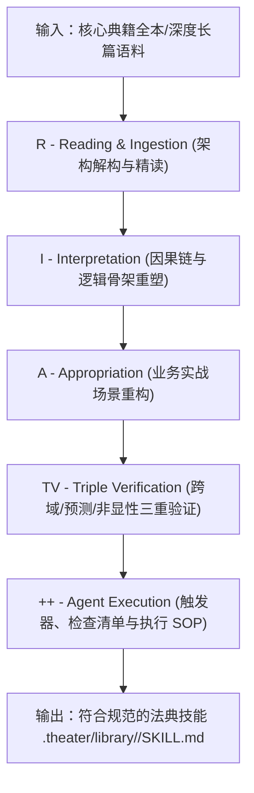

# 仓颉体系：经典法典技能化蒸馏标准模板 (Cangjie Distillation Template)

> **标准引用来源**：[kangarooking/cangjie-skill](https://github.com/kangarooking/cangjie-skill)  
> **核心哲学**：“把书、长视频、播客等高价值内容蒸馏成可执行的 Agent Skills（Distill high-value content into executable Agent Skills）。”  
> **在歌剧院中的职责**：将第一幕选定的核心经典法典（Canon），通过 RIA-TV++ 流水线，从泛读文本重构为具备严格触发条件、操作清单与质检标准的可执行技能包。

---

## 🧭 蒸馏流水线总览



---

## 📚 阶段一：RIA 核心方法论重构

### 1. R (Reading & Ingestion) —— 架构解构与精读
- **摄取通道**：
  - 本地通道：直接解析 `.theater/library/<book_slug>/raw/` 或工作区中的电子书/PDF/Markdown；
  - 检索通道：若无本地文本，调用 `deep-research` 聚合高质量书评精要、章节导读、作者公开论文及权威案例。
- **解构要素**：
  - **全书逻辑拓扑图**：各章节之间的层级递进与依赖关系；
  - **核心命题与公理**：作者立论的 1~3 个无法辩驳的底层假设；
  - **核心术语定义表**：消除模糊语言，定义书籍独有的概念词汇表；
  - **剥离冗余信息**：剔除为了出版灌水的轶事趣闻、时代局限案例，提取纯粹的方法论核。

### 2. I (Interpretation) —— 因果链与逻辑骨架重塑
- **因果机制解析**：
  - 现象背后的结构性成因：书籍指出的系统失灵根源（如组织熵增、认知窄化、信息不对称）；
  - 核心干预措施与传导路径：输入何种干预动作，会触发何种中间变量，最终导致何种系统状态变化；
- **概念模型骨架**：
  - 提炼 2~4 个结构化框架（如矩阵、漏斗、飞轮、双轨闭环）；
  - 明确各框架在不同维度的作用域。

### 3. A (Appropriation) —— 业务实战场景重构
- **由虚入实转化**：
  - 将作者叙述性的陈述句（“优秀的企业往往会...”），彻底翻译为面向工程、管理或决策的**祈使句**（“执行步骤 1：立即审计...并切断...”）；
- **实战场景匹配矩阵**：
  - 定义该方法论在现实中最适配的 3~5 类典型困境（如战略转型阵痛、产品冷启动停滞、技术债务爆发）；
  - 明确在何种特定业务场景下该方法论**绝对不适用（反向禁忌场景）**。

---

## 🔍 阶段二：TV 三重严格验证 (Triple Verification)

在封装为 Agent 技能前，必须对提取的方法论进行三重检验，不满足者驳回重新提炼：

1. **跨学科/跨领域佐证度 (Cross-Domain Evidence)**
   - 该方法论是否仅在某一狭窄行业的偶然经验？能否在物理学、生物演化、复杂系统工程、博弈论中找到同构原理佐证？
   - 若只能在单一语境成立，标明“弱通用性并补足约束条件”；若具备多学科共识，提炼为底层公理。
2. **推演预测力 (Predictive Power)**
   - 选取 2 个历史上遵循该方法论成功的经典案例，以及 2 个违背该方法论导致崩盘的反面案例；
   - 验证：在给定初始条件与外部约束下，该方法论的因果推演链能否准确预测事态发展走向。
3. **反常识与非显而易见性 (Non-Obviousness)**
   - 该方法论是否提供了超越平庸常识的洞见？
   - 严禁提炼出“我们要重视用户需求”、“要保持沟通顺畅”等显而易见的废话；必须具备“在常规直觉向左走时，框架指示你坚决向右走”的决断锐度。

---

## ⚙️ 阶段三：++ Agent 可执行层封装 (Agent Execution Layer)

仓颉的核心是将“知识”转化为“Agent 代码级可执行指令”：

### 1. 触发器与路由条件 (Triggers)
- 定义当面临何种关键词、何种状态信号时，Agent 必须主动调动该技能（如：“面临沉没成本决策时”、“业务增长失速且内部内卷时”）。

### 2. 前置输入检查清单 (Pre-condition Checklists)
- 在执行该方法论前，Agent 必须从用户或环境中收集齐全的结构化数据字段（如：财务数据、组织架构图、竞品能力对照表），缺一不可。

### 3. 分步执行标准操作规程 (Step-by-Step SOP)
- 严密的序号指令，包含每一个处理阶段、所需子工具、内部演算逻辑与产出形式。

### 4. 产出物验收检查清单 (Output Quality Checklists)
- 用于自检最终方案的打分表，每一项均为布尔判定（Yes/No），严禁模糊定性。

### 5. 常见误区与反模式自检 (Anti-Patterns & Traps)
- 列出执行该方法论时新手极易掉入的 3~5 个假动作陷阱，并给出纠偏指引。

---

## 📄 阶段四：标准化产出规范 (`.theater/library/<book_slug>/SKILL.md`)

```markdown
---
name: canon-<book_slug>
description: "核心经典法典技能：[书籍中文名]（[书籍外文名]）。基于仓颉 RIA-TV++ 标准蒸馏，包含完整方法论因果链、实战应用场景、触发器与可执行检查清单。"
---

# 核心法典方法论技能：[书籍名称]

## 1. 法典概览与核心立论
[简述全书架构、底层假设与不可动摇的核心公理]

## 2. 逻辑骨架与因果推演链 (Interpretation)
- **底层机制**：...
- **系统因果模型**：...
- **核心框架图解**：...

## 3. 实战应用映射与决策树 (Appropriation)
- **适配业务场景**：...
- **绝对禁忌场景**：...
- **决策判断树**：...

## 4. 三重验证审计报告 (Triple Verification)
- **跨领域佐证**：...
- **推演预测力**：...
- **非显而易见性洞见**：...

## 5. Agent 可执行工具箱 (Agent Execution Layer ++)
### 5.1 触发条件 (Triggers)
- ...

### 5.2 前置输入清单 (Prerequisites)
- [ ] 检查项 1：...
- [ ] 检查项 2：...

### 5.3 标准执行步骤 (Execution SOP)
1. 步骤一：...
2. 步骤二：...

### 5.4 验收与质检清单 (Checklists)
- [ ] 质检项 1：...
- [ ] 质检项 2：...

### 5.5 反模式与陷阱警示 (Anti-Patterns)
- **陷阱 1**：... -> **纠偏方案**：...
```
