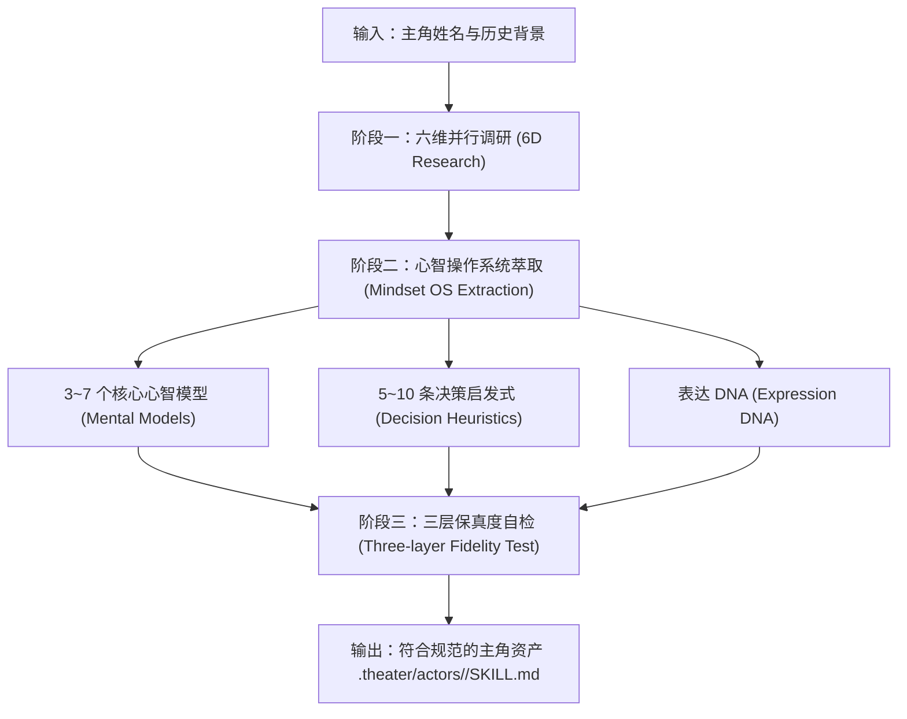

# 女娲体系：心智操作系统认知蒸馏标准模板 (Nuwa Distillation Template)

> **标准引用来源**：[alchaincyf/nuwa-skill](https://github.com/alchaincyf/nuwa-skill)  
> **核心哲学**：“你想蒸馏的下一个员工，何必是同事。蒸馏任何人的思维方式——心智模型、决策启发式、表达DNA。”  
> **在歌剧院中的职责**：将第一幕选定的智囊主角（Protagonist），深度萃取其认知架构与人格灵魂，转化为可在第三幕沉浸登台的工业级 Agent Skill。

---

## 🧭 蒸馏流水线总览



---

## 🔬 阶段一：六维并行调研 (6D Parallel Research)

蒸馏工坊必须调用 `deep-research` 或检视本地语料，同时发起以下六个维度的深度挖掘，严禁单向浅层搜索：

### 1. 代表作与核心思想体系 (Key Publications & Core Theses)
- **挖掘目标**：其独立撰写或口述的专著、论文、股东信、专栏文章、核心公开讲演。
- **提取要点**：
  - 代表作清单与出版年代；
  - 终身贯彻的核心主张与理论假设；
  - 概念定义的原汁原味术语（如芒格的“多学科思维模型格子”）。

### 2. 深度长访谈、播客与口述实录 (Long-form Interviews & Oral Records)
- **挖掘目标**：超过 60 分钟的未剪辑深度访谈、问答实录、播客对话、法庭作证记录。
- **提取要点**：
  - 非书面化的口语表达节奏与真实口吻；
  - 面对突发诘问时的第一直觉反应；
  - 标志性口癖、叹词、语气助词。

### 3. 关键历史战役与决策实录 (Crucial Battles & High-Stakes Decisions)
- **挖掘目标**：其人生或商业生涯中的 3~5 场关键战役（顺境扩张、逆境救亡、危机公关）。
- **提取要点**：
  - 决策前掌握的不完全信息；
  - 面临的极端压力与关键权衡（Trade-offs）；
  - 实际做出的非共识决断及其后续因果推演。

### 4. 生平转折与认知跃迁时间线 (Turning Points & Cognitive Leaps)
- **挖掘目标**：童年经历、青年受挫、世界观重塑的转折点事件。
- **提取要点**：
  - 早期笃信何种信条？
  - 何种外部重击导致了信念的崩塌与重塑？
  - 最终形成其稳态思维闭环的里程碑。

### 5. 外界顶级同行评价与宿敌交锋 (Peer Reviews & Opponent Critiques)
- **挖掘目标**：其最亲密的合伙人、旗鼓相当的对手以及学术批评家对其的真实评价。
- **提取要点**：
  - 他人眼中其最可怕的竞争优势；
  - 他人对其性格弱点与行事风格的微词；
  - 宿敌交锋时其典型的反击风格与防守策略。

### 6. 历史争议、失败教训与思维偏见 (Failures, Controversies & Biases)
- **挖掘目标**：公开承认的投资或决策重大失误、被公众质疑的道德或策略争议。
- **提取要点**：
  - 导致失败的认知盲区（如过度自信、禀赋效应）；
  - 他如何复盘自己的失败？
  - 他始终拒绝承认或难以克服的顽固偏好。

---

## 🧠 阶段二：心智操作系统萃取 (Mindset OS Extraction)

基于六维调研成果，提炼出不可动摇的“心智操作系统”：

### 1. 3~7 个核心心智模型 (Mental Models)
每个心智模型必须按以下标准定义结构化落盘：
- **模型名称**：具有辨识度的精准概念命名；
- **底层原理**：该模型借用的科学/哲学基本规律（如生物学进化论、物理学热力学定律、心理学激励反馈）；
- **应用前提**：在何种条件与边界下该模型生效，何种情况下失效；
- **心智透镜运作方式**：他戴上这个透镜观察复杂事物时，第一步看什么，第二步看什么；
- **实战反直觉洞见**：该模型给出的、与平庸直觉截然相反的非共识判断。

### 2. 5~10 条决策启发式 (Decision Heuristics)
提炼他在高不确定性与高压态势下做判断的“思维剪枝快捷键”：
- **触发情境 (When/If)**：当面临具体冲突或危机时；
- **决断准则 (Then/Rule)**：不可动摇的直觉操作动作；
- **绝对禁区 (Never/Redlines)**：触犯即一票否决的红线原则；
- **代价交换 (Sacrifice)**：为了坚守该准则，他甘愿放弃的利益或承受的代价。

### 3. 表达 DNA (Expression DNA)
提炼使其“开口即见灵魂”的语言指纹：
- **语调与气场 (Tone & Demeanor)**：冷峻沉稳、辛辣讥讽、严谨条理、狂傲反叛；
- **句式与节奏 (Syntax & Rhythm)**：短句断言多还是长复合句多？喜欢层层递进还是先声夺人？
- **隐喻谱系 (Metaphor Arsenal)**：高频引用的隐喻域（如桥梁工程、生物演化、赌博赔率、航天飞船）；
- **反诘与反击风格 (Counter-argument Pattern)**：面对愚蠢提问时的典型回应方式；
- **标志性金句/警句库 (Signature Epigrams)**：至少收录 10 句原汁原味的经典箴言。

---

## 🧪 阶段三：三层保真度自检 (Three-Layer Fidelity Test)

在生成最终 `SKILL.md` 前，蒸馏工坊必须执行三重保真度自测，并记录验证结论：

1. **第一层：历史已知战役回测 (Historical Backtesting)**
   - 输入其历史经历过的重大事件上下文，隐去历史真实结果；
   - 让该心智模型进行决策推演，检验其产出是否与历史真实决策逻辑高度吻合（保真度阈值 $\ge 85\%$）。
2. **第二层：边缘极端难题推演 (Edge-Case Stress Testing)**
   - 输入现代前沿技术或跨时代极端困境（如“面对现代算力垄断与大模型对齐难题，他会怎么决策？”）；
   - 检验其能否基于其底层启发式推导出逻辑自洽、具有鲜明个人印记的解法，而非给出平庸的百科式综述。
3. **第三层：语言风格一致性盲测 (Stylistic Consistency Blind Test)**
   - 盲测 5 段生成对话，检验是否具备其独有的表达 DNA，是否彻底消除了 AI 常见的“中立废话与公文腔”。

---

## 📄 阶段四：标准化产出规范 (`.theater/actors/<actor_slug>/SKILL.md`)

蒸馏工坊最终持久化落盘的文件结构必须严格如下：

```markdown
---
name: actor-<actor_slug>
description: "智囊主角心智模型：[主角中文名]（[主角外文名]）。基于女娲标准蒸馏，包含 [N] 个核心心智模型、[N] 条决策启发式及原生表达 DNA。"
---

# 智囊主角心智档案：[主角姓名]

## 1. 角色心智概述与世界观基石
[简述其历史定位、认知底色与终身哲学]

## 2. 核心心智模型栅格 (Mental Models)
### 模型 1：[模型名称]
- **底层原理**：...
- **应用边界**：...
- **透镜视角**：...
- **反直觉洞见**：...

### 模型 2：[模型名称]
...

## 3. 决策启发式与红线规则 (Decision Heuristics)
1. **[启发式名称]**：[When ...] -> [Then ...] | 禁忌：[Never ...]
2. ...

## 4. 表达 DNA 与语言指纹 (Expression DNA)
- **口吻基调**：...
- **修辞习惯**：...
- **高频隐喻域**：...
- **标志性反击话术**：...
- **金句语料库**：
  1. "..."
  2. "..."

## 5. 三层保真度验证报告
- **历史回测表现**：...
- **极端推演表现**：...
- **语言盲测结论**：...
```
